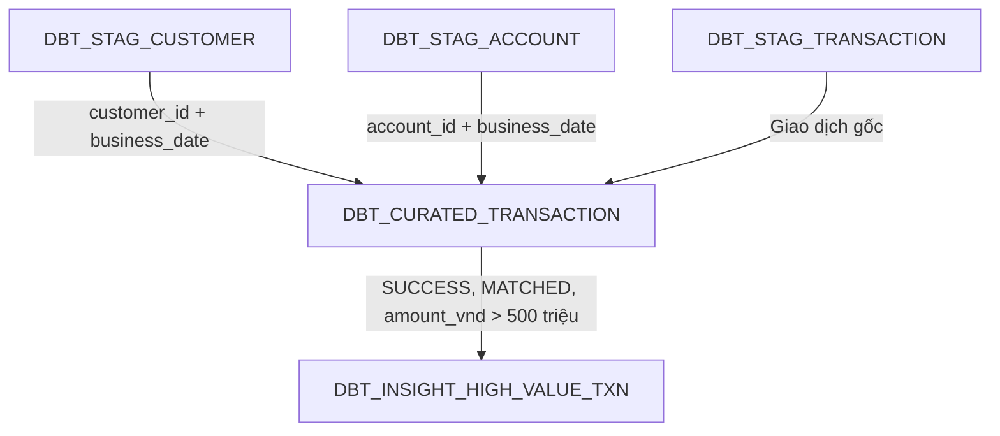

# Oracle 19c dbt Test Pipeline

## 1. Mục đích

Pipeline này cung cấp bộ dữ liệu nhỏ để kiểm thử luồng xử lý dữ liệu trên Oracle 19c theo ba lớp:

- **STAG**: lưu dữ liệu nguồn về giao dịch, khách hàng và tài khoản.
- **CURATED**: kết hợp giao dịch với thông tin khách hàng và tài khoản.
- **INSIGHT**: lưu các giao dịch giá trị cao, lớn hơn 500 triệu VND.

Toàn bộ bảng đều có trường `business_date` và được partition theo ngày.

## 2. Thành phần bàn giao

| File | Mục đích |
|---|---|
| `oracle19_dbt_pipeline_01_ddl_seed.sql` | Tạo bảng, index, partition và dữ liệu kiểm thử |
| `oracle19_dbt_pipeline_02_transform.sql` | Thực hiện transform `STAG → CURATED → INSIGHT` theo một `business_date` |
| `oracle19_dbt_pipeline_README.md` | Mô tả kiến trúc, quy tắc xử lý và cách kiểm thử pipeline |

## 3. Kiến trúc pipeline



Pipeline xử lý độc lập theo từng ngày nghiệp vụ. Dữ liệu ngày nào chỉ được join với snapshot customer và account của chính ngày đó.

## 4. Thiết kế partition

Tất cả các bảng sử dụng:

```sql
PARTITION BY RANGE (business_date)
INTERVAL (NUMTODSINTERVAL(1, 'DAY'))
```

Oracle tự tạo partition mới khi insert dữ liệu của một ngày chưa tồn tại.

Quy ước:

- `business_date` có kiểu `DATE`.
- Giá trị phải ở đầu ngày, tức `00:00:00`.
- Khóa chính luôn bao gồm `business_date` để phù hợp với local partitioned index.
- Transform luôn lọc trực tiếp theo `business_date` để Oracle thực hiện partition pruning.

## 5. STAG layer

### 5.1. `DBT_STAG_CUSTOMER`

Lưu snapshot khách hàng theo ngày.

| Nhóm trường | Trường chính | Ý nghĩa |
|---|---|---|
| Định danh | `customer_id` | Mã khách hàng |
| Thông tin cơ bản | `customer_name`, `customer_type`, `date_of_birth` | Thông tin nhận diện khách hàng |
| KYC | `national_id`, `country_code` | Giấy tờ và quốc gia |
| Rủi ro | `risk_level` | `LOW`, `MEDIUM` hoặc `HIGH` |
| Kỹ thuật | `created_at`, `updated_at`, `business_date` | Thời gian ghi nhận và ngày dữ liệu |

Khóa chính:

```text
(customer_id, business_date)
```

### 5.2. `DBT_STAG_ACCOUNT`

Lưu snapshot tài khoản theo ngày.

| Nhóm trường | Trường chính | Ý nghĩa |
|---|---|---|
| Định danh | `account_id`, `account_number` | Khóa kỹ thuật và số tài khoản |
| Chủ tài khoản | `customer_id` | Liên kết tới customer snapshot |
| Phân loại | `account_type`, `currency_code` | Loại tài khoản và loại tiền |
| Trạng thái | `account_status` | `ACTIVE`, `DORMANT`, `CLOSED` hoặc `BLOCKED` |
| Thuộc tính | `open_date`, `branch_code`, `current_balance` | Ngày mở, chi nhánh và số dư |
| Kỹ thuật | `created_at`, `updated_at`, `business_date` | Thời gian ghi nhận và ngày dữ liệu |

Khóa chính:

```text
(account_id, business_date)
```

### 5.3. `DBT_STAG_TRANSACTION`

Lưu dữ liệu giao dịch phát sinh.

| Nhóm trường | Trường chính | Ý nghĩa |
|---|---|---|
| Định danh | `transaction_id` | Mã giao dịch |
| Tài khoản | `account_id` | Tài khoản thực hiện giao dịch |
| Thời gian | `transaction_ts` | Thời điểm giao dịch |
| Giá trị | `amount`, `currency_code`, `amount_vnd` | Số tiền nguyên tệ và giá trị quy đổi VND |
| Phân loại | `transaction_type`, `debit_credit_ind`, `channel_code` | Loại giao dịch, chiều tiền và kênh |
| Trạng thái | `transaction_status` | `SUCCESS`, `PENDING`, `FAILED` hoặc `REVERSED` |
| Bổ sung | `counterparty_account`, `transaction_desc`, `source_system` | Đối tác, nội dung và hệ thống nguồn |
| Kỹ thuật | `created_at`, `business_date` | Thời gian nạp và ngày dữ liệu |

Khóa chính:

```text
(transaction_id, business_date)
```

`amount_vnd` là trường được sử dụng để kiểm tra ngưỡng 500 triệu, tránh so sánh trực tiếp các giao dịch khác loại tiền.

## 6. CURATED layer

### `DBT_CURATED_TRANSACTION`

Bảng CURATED chứa dữ liệu giao dịch đã được enrich với account và customer.

Logic join:

```sql
FROM dbt_stag_transaction t
LEFT JOIN dbt_stag_account a
  ON a.account_id = t.account_id
 AND a.business_date = t.business_date
LEFT JOIN dbt_stag_customer c
  ON c.customer_id = a.customer_id
 AND c.business_date = a.business_date
WHERE t.business_date = :business_date
```

Pipeline dùng `LEFT JOIN` để không làm mất giao dịch khi thiếu dữ liệu customer hoặc account.

### Quy tắc chất lượng dữ liệu

Trường `data_quality_status` được xác định như sau:

| Điều kiện | Giá trị |
|---|---|
| Không tìm thấy account của cùng ngày | `ACCOUNT_NOT_FOUND` |
| Tìm thấy account nhưng không tìm thấy customer của cùng ngày | `CUSTOMER_NOT_FOUND` |
| Khớp đủ transaction, account và customer | `MATCHED` |

Nhờ đó, CURATED vừa giữ đủ giao dịch đầu vào vừa cho phép kiểm thử các trường hợp dữ liệu tham chiếu bị thiếu.

## 7. INSIGHT layer

### `DBT_INSIGHT_HIGH_VALUE_TXN`

Bảng này lưu giao dịch giá trị cao thỏa mãn đồng thời các điều kiện:

```sql
transaction_status = 'SUCCESS'
AND data_quality_status = 'MATCHED'
AND amount_vnd > 500000000
```

Lưu ý:

- Giao dịch bằng đúng `500,000,000` VND không được chọn vì yêu cầu là **lớn hơn** 500 triệu.
- Giao dịch `REVERSED`, `FAILED` hoặc `PENDING` không được chọn.
- Giao dịch thiếu account hoặc customer vẫn tồn tại trong CURATED nhưng không được công bố sang INSIGHT.
- `threshold_amount_vnd` được ghi vào bảng để thể hiện ngưỡng áp dụng tại thời điểm xử lý.

## 8. Cơ chế incremental và rerun

File transform xử lý một ngày nghiệp vụ tại mỗi lần chạy:

```sql
DEFINE p_business_date = 20260920;
```

Trình tự xử lý:

1. Xóa dữ liệu INSIGHT của `business_date` được chọn.
2. Xóa dữ liệu CURATED của `business_date` được chọn.
3. Đọc ba bảng STAG và tạo lại dữ liệu CURATED.
4. Đọc CURATED và tạo lại dữ liệu INSIGHT.
5. Commit toàn bộ giao dịch.
6. Gather optimizer statistics.
7. Chạy các câu query kiểm tra kết quả.

Cơ chế `DELETE + INSERT` giúp script có tính idempotent: chạy lại cùng một ngày không làm nhân đôi dữ liệu.

Nếu lỗi xảy ra trước `COMMIT`, script thực hiện `ROLLBACK` để tránh trạng thái CURATED và INSIGHT không đồng nhất.

## 9. Dữ liệu kiểm thử

Seed data gồm hai ngày:

- `2026-09-20`
- `2026-09-21`

### Ngày `2026-09-20`

| Transaction | Tình huống | Kết quả mong đợi |
|---|---|---|
| `T20260920001` | 100 triệu, `SUCCESS` | Có trong CURATED, không có trong INSIGHT |
| `T20260920002` | 600 triệu, `SUCCESS`, khớp đủ dữ liệu | Có trong CURATED và INSIGHT |
| `T20260920003` | Bằng đúng 500 triệu | Có trong CURATED, không có trong INSIGHT |
| `T20260920004` | 750 triệu, account tồn tại nhưng thiếu customer | CURATED có trạng thái `CUSTOMER_NOT_FOUND` |
| `T20260920005` | 900 triệu nhưng `REVERSED` | Có trong CURATED, không có trong INSIGHT |
| `T20260920006` | 800 triệu nhưng không tìm thấy account | CURATED có trạng thái `ACCOUNT_NOT_FOUND` |

Kết quả tổng hợp mong đợi:

| Layer hoặc trạng thái | Số bản ghi |
|---|---:|
| STAG transaction | 6 |
| CURATED transaction | 6 |
| INSIGHT high-value transaction | 1 |
| `MATCHED` | 4 |
| `CUSTOMER_NOT_FOUND` | 1 |
| `ACCOUNT_NOT_FOUND` | 1 |

### Ngày `2026-09-21`

| Transaction | Tình huống | Kết quả mong đợi |
|---|---|---|
| `T20260921001` | 550 triệu, `SUCCESS` | Có trong INSIGHT |
| `T20260921002` | 25 triệu, `SUCCESS` | Không có trong INSIGHT |
| `T20260921003` | 1,2 tỷ, `SUCCESS` | Có trong INSIGHT |

Kết quả tổng hợp mong đợi:

| Layer | Số bản ghi |
|---|---:|
| STAG transaction | 3 |
| CURATED transaction | 3 |
| INSIGHT high-value transaction | 2 |

## 10. Cách chạy

### Bước 1: tạo bảng và seed data

```sql
@oracle19_dbt_pipeline_01_ddl_seed.sql
```

Script này sẽ drop các bảng test nếu đã tồn tại, sau đó tạo lại toàn bộ bảng và dữ liệu mẫu.

### Bước 2: chọn ngày xử lý

Mở file `oracle19_dbt_pipeline_02_transform.sql` và sửa:

```sql
DEFINE p_business_date = 20260920;
```

Giá trị phải theo định dạng `YYYYMMDD`.

### Bước 3: chạy transform

```sql
@oracle19_dbt_pipeline_02_transform.sql
```

Để kiểm thử incremental cho ngày thứ hai:

```sql
DEFINE p_business_date = 20260921;
```

Sau đó chạy lại file transform.

## 11. Kiểm tra kết quả

### Kiểm tra số lượng theo layer

```sql
SELECT business_date, COUNT(*)
FROM dbt_stag_transaction
GROUP BY business_date
ORDER BY business_date;

SELECT business_date, COUNT(*)
FROM dbt_curated_transaction
GROUP BY business_date
ORDER BY business_date;

SELECT business_date, COUNT(*)
FROM dbt_insight_high_value_txn
GROUP BY business_date
ORDER BY business_date;
```

### Kiểm tra chất lượng join

```sql
SELECT business_date, data_quality_status, COUNT(*) AS row_count
FROM dbt_curated_transaction
GROUP BY business_date, data_quality_status
ORDER BY business_date, data_quality_status;
```

### Kiểm tra giao dịch lớn hơn 500 triệu

```sql
SELECT
    transaction_id,
    customer_id,
    account_number,
    amount_vnd,
    business_date
FROM dbt_insight_high_value_txn
ORDER BY business_date, transaction_id;
```

### Kiểm tra partition pruning

```sql
EXPLAIN PLAN FOR
SELECT *
FROM dbt_curated_transaction
WHERE business_date = DATE '2026-09-20';

SELECT * FROM TABLE(DBMS_XPLAN.DISPLAY);
```

Trong execution plan, kiểm tra các cột `PSTART` và `PSTOP` để xác nhận Oracle chỉ đọc partition tương ứng.

## 12. Mapping sang dbt model

Khi chuyển từ SQL test sang project dbt, có thể tổ chức model như sau:

```text
models/
├── stag/
│   ├── dbt_stag_customer.sql
│   ├── dbt_stag_account.sql
│   └── dbt_stag_transaction.sql
├── curated/
│   └── dbt_curated_transaction.sql
└── insight/
    └── dbt_insight_high_value_txn.sql
```

Quan hệ phụ thuộc:

```text
dbt_stag_customer ---------┐
dbt_stag_account ----------+--> dbt_curated_transaction --> dbt_insight_high_value_txn
dbt_stag_transaction ------┘
```

Trong dbt, nên truyền ngày xử lý bằng biến:

```bash
dbt run --vars '{business_date: "20260920"}'
```

Ví dụ lấy biến trong model:

```sql


WHERE business_date = TO_DATE('{{ business_date }}', 'YYYYMMDD')
```

Các test dbt nên có:

- `not_null` cho các khóa và `business_date`.
- `unique` cho tổ hợp khóa nghiệp vụ với `business_date`.
- `accepted_values` cho `transaction_status`, `account_status`, `risk_level` và `data_quality_status`.
- Relationship test giữa transaction và account, account và customer nếu pipeline yêu cầu reject bản ghi không khớp.
- Singular test bảo đảm bảng INSIGHT không chứa `amount_vnd <= 500000000`.

## 13. Lưu ý vận hành

- File DDL sẽ drop và tạo lại bảng, chỉ dùng cho môi trường test.
- Không chạy file DDL/seed trên schema production.
- Cần quyền `CREATE TABLE`, `DROP TABLE`, `CREATE INDEX` và thực thi `DBMS_STATS`.
- Dữ liệu mẫu không có khóa ngoại vật lý nhằm cho phép kiểm thử các trường hợp thiếu account/customer.
- Nếu chạy từ công cụ không hỗ trợ lệnh SQL*Plus như `DEFINE`, cần truyền ngày bằng biến bind hoặc thay trực tiếp giá trị ngày trong script transform.
